<div align="center">


# Chaukas

**A private scam shield for families, powered by Firebase AI Logic hybrid inference.**

*Chaukas (चौकस) is Hindi for "alert, watchful".*

Share a suspicious message from WhatsApp or SMS, drop in a screenshot, or say what a caller told you. On Android it can even warn you **before you open the message**. Chaukas checks it **on your device** with Gemini Nano, points at the exact words that give the scam away, and tells you what to do next. When the on-device model can't help, it falls back to Gemini in the cloud, but only after **removing your personal details locally**.

[](https://github.com/Anushka180712/Build-HybridAI/actions/workflows/ci.yml)


Built for [#BuildHybridAI 2026](https://firebasehybridaihackathon.devpost.com/)


</div>

---

## Contents

1. [The problem](#the-problem)
2. [What Chaukas does](#what-chaukas-does)
3. [No copy-paste needed](#no-copy-paste-needed)
4. [A 3-minute tour](#a-3-minute-tour)
5. [Hybrid inference](#hybrid-inference)
6. [Architecture](#architecture)
7. [Privacy and security](#privacy-and-security)
8. [Testing](#testing)
9. [Setup](#setup)
10. [Project structure](#project-structure)
11. [Hackathon requirements](#hackathon-requirements)
12. [License](#license)

---

## The problem

Scam messages are now the most common way ordinary people lose money. In India, citizens lost **₹22,845 crore to cyber fraud in 2024, a 206% rise on the previous year**, according to figures the Ministry of Home Affairs gave Parliament ([Scroll](https://scroll.in/latest/1084796/indians-lost-rs-22845-crore-to-cyber-fraud-in-2024-a-206-rise-from-previous-year-centre)). In the US, people reported **$12.5 billion** in fraud losses in 2024 ([FTC](https://www.ftc.gov/news-events/news/press-releases/2025/03/new-ftc-data-show-big-jump-reported-losses-fraud-125-billion-2024)).

The people targeted most, such as parents, grandparents and first-time smartphone users, are the least likely to ask for help. The messages they need checked are also the most private ones they have: bank alerts, KYC notices, texts from "a son with a new number". Pasting those into a cloud chatbot is exactly what a careful person won't do.

**That is where on-device AI stops being a nice-to-have and becomes the whole point.** Chaukas runs the check where the message already is, explains its reasoning so people learn the patterns, and uses the cloud only when it adds value and only with personal details removed.

### Who it is for

> *Kamla, 67, gets an SMS at 9 PM: "Your electricity will be disconnected tonight at 9:30. Call 98xxxxxx10." Her Android phone shows a Chaukas warning before she even opens it. Unsure, she opens Chaukas, which her daughter set to answer in हिन्दी, taps* Speak *and reads the message out. She hears "रुकिए! यह धोखा लगता है" with three things not to do, and one tap calls her daughter. The warning also lands in her family group automatically. Her phone number and bill details never left the phone.*

That is the bar Chaukas is built to: **no typing, no English needed, no private message sent anywhere, and an answer in seconds.** The same flow protects a student in Ohio from a fake toll text.

### India-first, works anywhere

Chaukas is designed around India, where UPI put digital payments in every pocket and scams followed. None of that limits anyone else:

| | Everywhere | Extra depth for India |
|---|---|---|
| Detection | Scam patterns, look-alike links, gift cards, crypto, "Hi Mum" texts, toll and parcel fees, remote-access tricks | UPI collect requests and QR "refunds", KYC/PAN/Aadhaar updates, "digital arrest", power-cut threats |
| Privacy | Phone numbers, emails, card and account numbers, codes, your own words | Indian mobiles, UPI IDs, PAN and Aadhaar numbers |
| Language | Explanations in 14 languages, with an optional casual tone (Hinglish for Hindi) | Answer-language chips for English, Hindi, Bengali, Tamil, Telugu and Marathi on the home screen, with voice in and out |
| Reporting | US, UK, Canada and Australia, plus a fallback for every other country (your bank, econsumer.gov, local police) | 1930 helpline, cybercrime.gov.in, Chakshu, SMS 1909 |

Adding a country is one entry in [`report.ts`](web/src/lib/report.ts). Adding a spoken-verdict language is one block in [`verdictWords.ts`](web/src/lib/verdictWords.ts), and a test checks that no line is missing.

## What Chaukas does

<table>
<tr>
<td width="50%" valign="top">

**Easy for everyone, on one screen**
- A large **Speak** button under the message box: read the message out, and it stops by itself when you pause. Answers can be **read out loud**.
- **One tap switches the language** to English, हिन्दी, বাংলা, தமிழ், తెలుగు or मराठी: the menus, buttons and result headings change, and the answer comes in that language too (14 answer languages in Settings, behind the gear icon), plus an optional **casual tone**.
- **Dynamic Multilingual Samples**: One-tap sample chips (QR "refund", KYC update, UPI refund, Electricity bill) populate the text box directly in your chosen language (English, हिन्दी, বাংলা, தமிழ், తెలుగు, मराठी) so non-English speakers can test detection in their mother tongue immediately.
- **Smart Contact Awareness & Dual Action**:
  - **Unknown senders**: Risky scam messages (score 65+) automatically record to **Local History** and automatically share with the **Family Circle** group to protect everyone.
  - **Saved contacts**: When a risky message comes from someone in your phone contacts (e.g. hacked account or SIM swap), Chaukas warns privately and gives two explicit actions: **Share as scam** (adds to Circle & History) or **It's okay** (instantly dismisses without saving or sharing).
- Risky results show the verdict in your language, three things *not* to do, **Call my family** and **Call 1930** buttons, and **Send to WhatsApp**, which opens WhatsApp with the warning already written (personal details removed, links unclickable).

**Check anything**
- **Share** a message or screenshot from any app, or paste it. On Android, **automatic warnings** for new SMS and WhatsApp messages (see [No copy-paste needed](#no-copy-paste-needed)).
- **Camera & Photo scan**: take a photo or attach an image of any paper notice, letter, or screen. High-resolution camera capture with on-device multi-script OCR (Latin + Devanagari) extracts text, links, and phone numbers before hybrid checking.
- **Speak**: a large button under the message box. Read a message aloud, or say what a caller told you, in English or an Indian language. Your words appear live as you talk, in the language you picked, in Chrome (desktop and Android) and Safari (Mac and iPhone). Where a browser has no live recognition (Brave, Firefox, some in-app browsers), a short recording is written down by Gemini through Firebase AI Logic instead; only the audio is sent for that, and the check itself still follows your privacy mode. The Android app has its own **Speak** button with live words and a language picker, using the phone's speech recogniser.
- **Screenshots stay private**: when a screenshot would need the cloud (no Gemini Nano), Chaukas first **reads its words on the device** (Tesseract, served by the app, loaded only when needed) and sends only that text, with personal details removed. The picture itself is sent only if the person taps *Send the picture anyway*.
- **QR and UPI inspector**: decodes QR codes in screenshots *on the device* and says what scanning would really do: *"Scanning this will SEND ₹4,999 to…"*.
- **Instant signals** while you type: urgency, threats, KYC/UPI PIN tricks, "digital arrest", look-alike links and more.

</td>
<td width="50%" valign="top">

**Understand it**
- A clear verdict, a 0 to 100 risk score, and every red flag **quoted and highlighted** in the message.
- **Interactive Red Flag Breakdown**: Tap any red flag to open an expanded view explaining the exact deceptive phrase, psychological trick (e.g. panic cut, fake KYC), and safe next steps.
- "What to do now" checklist and a safe reply you can copy.
- **Explain in my language**: Hindi, Bengali, Tamil, Telugu, Marathi, Kannada, Malayalam, Gujarati, Punjabi, Spanish, Japanese, French, Portuguese or English.
- **Ask a follow-up** ("I already clicked, what now?") with streamed answers. **Read aloud** for anyone who finds small text hard.

</td>
</tr>
<tr>
<td valign="top">

**Act on it**
- **Report it** with the right contacts for your country. For India, includes 4 official quick actions on both Web and Android:
  - 📞 **1930 Helpline dialer**: One tap calls the National Cybercrime Reporting Portal helpline.
  - 🌐 **cybercrime.gov.in**: Direct official portal filing.
  - 🛡️ **Chakshu (DoT)**: Sanchar Saathi suspect fraud reporting.
  - 💬 **SMS 1909**: Telecom spam & unsolicited commercial communication reporting.
- **"I already paid or shared a code"**: an expanded first-hour recovery plan with step-by-step guidance, starting with the call that can still freeze the money (bank helpline + 1930), followed by card blocks and cybercrime reporting.
- **Scam alert picture**: a WhatsApp-ready card with personal details removed, made in the browser.

</td>
<td valign="top">

**Stay safe together**
- **Family Circle**: join with just a name (no email, password or phone number). The name is confirmed once and then stays fixed. Everyone gets a **personal Chaukas ID and QR code** made from the name they gave plus four digits (like `riya-4821`; names in Hindi, Bengali, Tamil or Telugu script are spelled in Latin letters, so नानी becomes `nani-0712`). Scanning someone's QR or typing their ID opens a **Keep or not** popup; Keep makes your family group with them on the spot, and they get the same popup on their phone. Each person can be in **up to two groups**, sees every member with their Chaukas ID, and can **Keep or Don't keep** an invite later from a *Waiting for you* list. Messages scoring **65 or more** are **shared with the group automatically** (safe messages never are), and group warnings **disappear after 3 days**. Family can react (*I got this too*, *I'll call you*) or forward a warning. A **one-tap WhatsApp or SMS link** brings in people who don't have Chaukas yet. When someone shares a warning, the rest of the group gets a **notification** (while Chaukas is open or in a background tab).
- **Group Code side-by-side & quick join**: Groups prominently display a 6-character Group Code (`Code: ABC123`) right beside the group name with 1-tap copy. Family members who don't have a QR scanner can easily join using this code, even if already participating in another circle (up to 2 groups).
- **Forward a warning on WhatsApp or SMS**: personal details removed and scam links made unclickable (`bad[.]top`), so nobody taps them by accident.
- **Scam Dojo (Instant 0ms load)**: an interactive training game on both Web and Android, fully localized across 6 Indian languages (English, Hindi, Bengali, Tamil, Telugu, Marathi), with instant offline scenarios and background AI round generation to train your detection instincts.
- **History and insights**: what is targeting you, the tricks you see most and how often checks stayed on your device.

</td>
</tr>
</table>

<p align="center">
  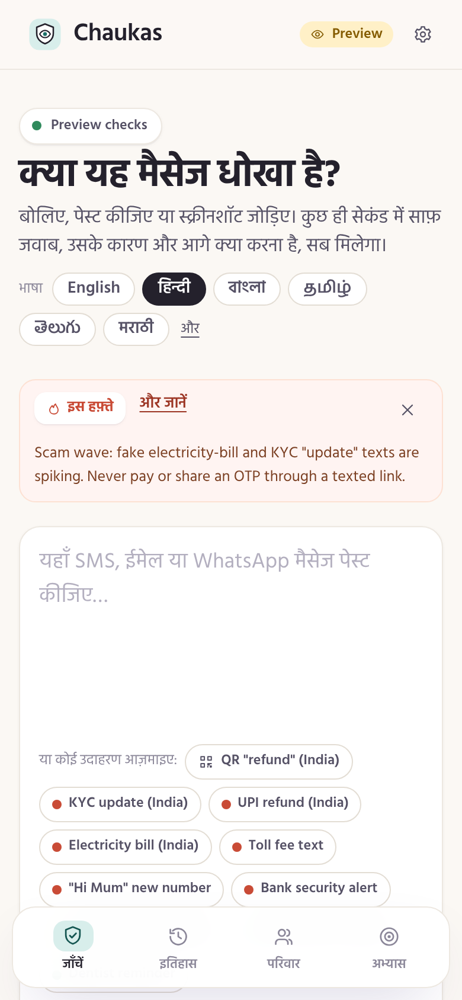
  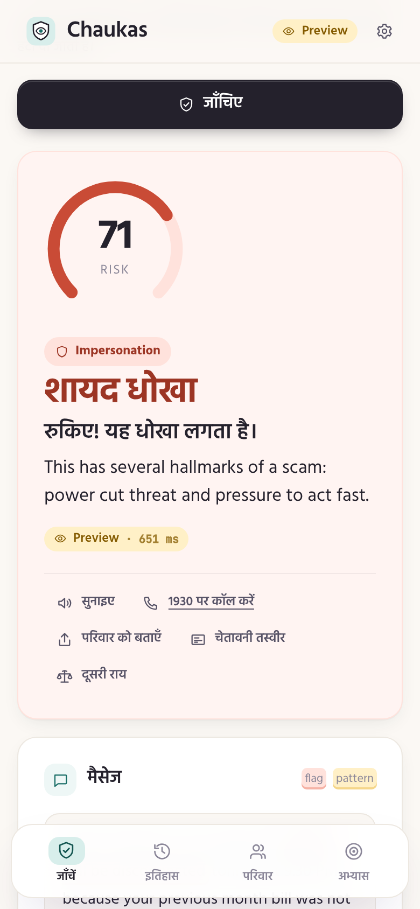
</p>
<p align="center">
  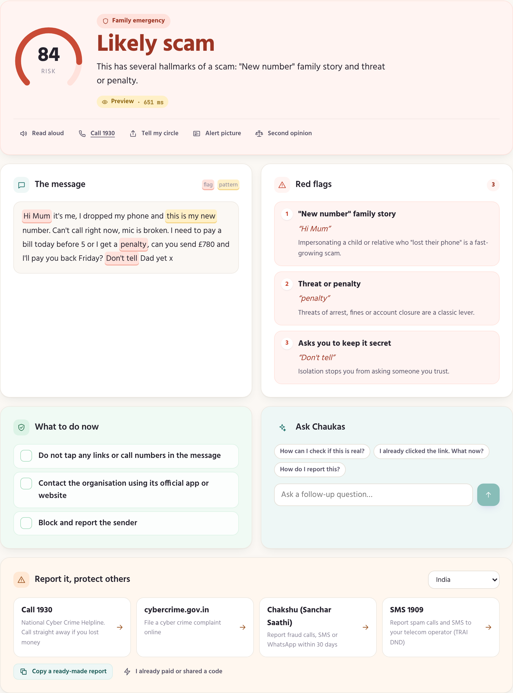
</p>
<p align="center">
  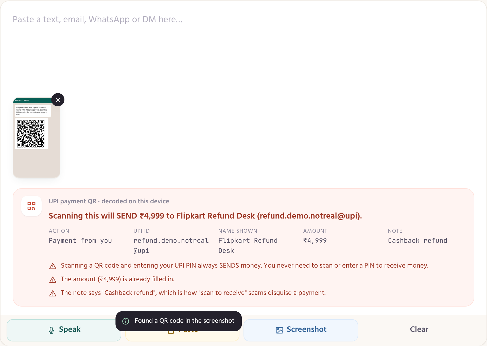
  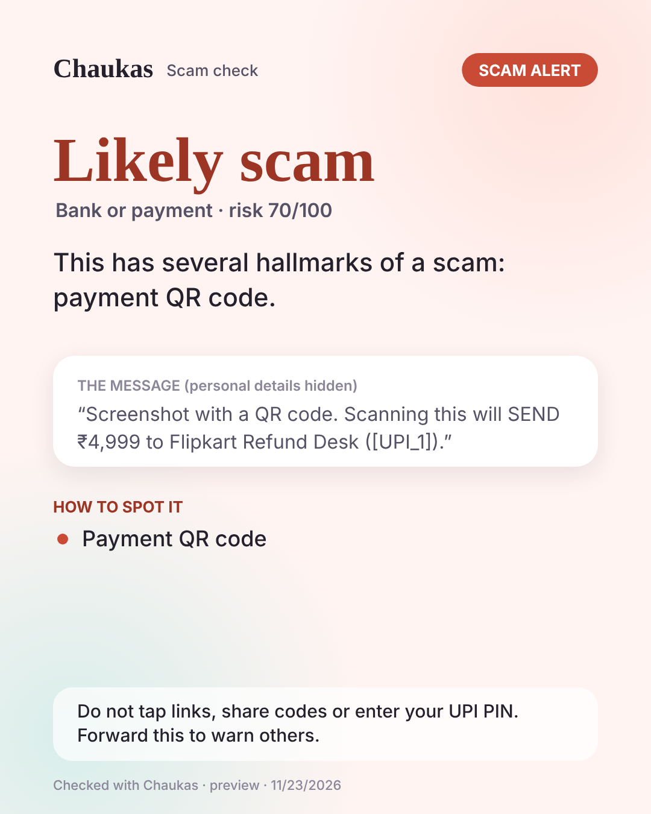
</p>
<p align="center">
  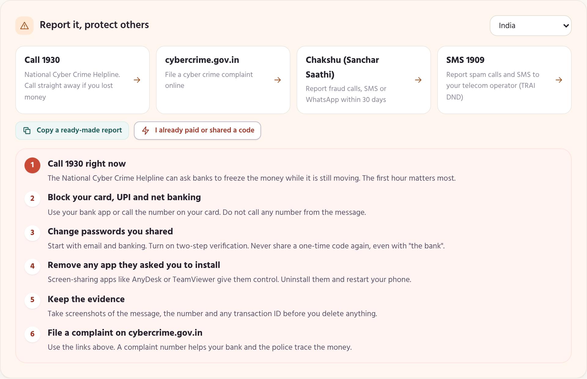
</p>
<p align="center">
  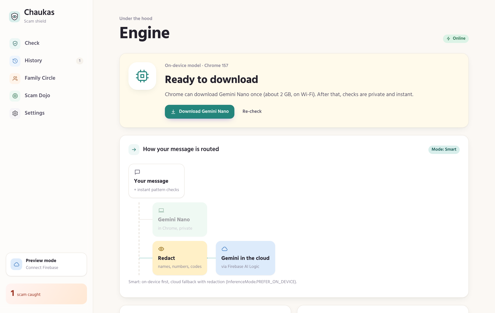
  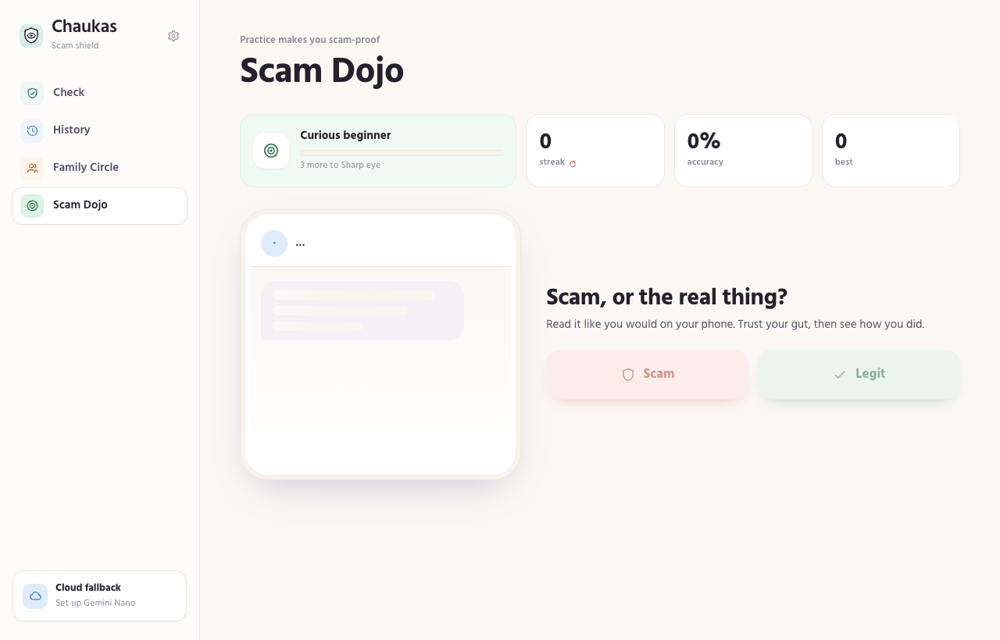
</p>
<p align="center">
  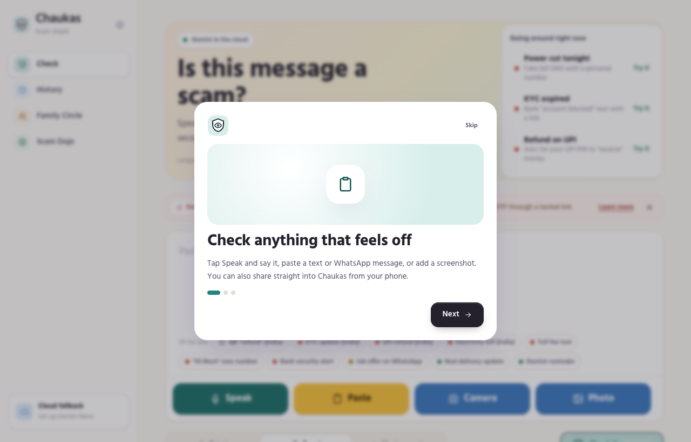
</p>
<p align="center">
  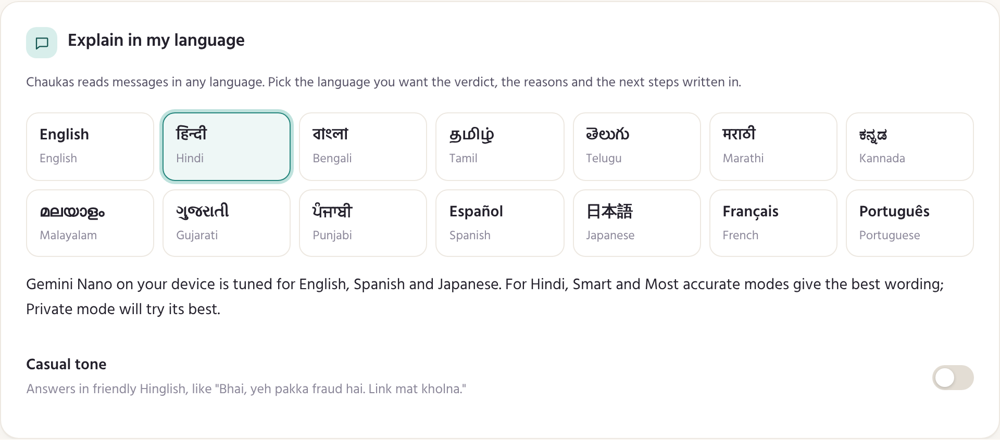
  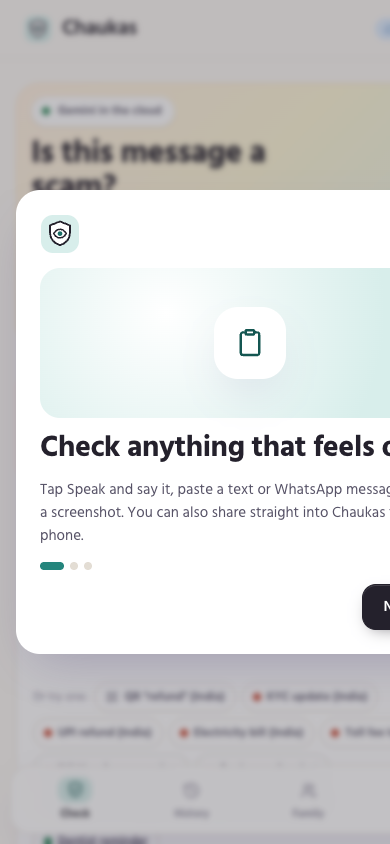
</p>

## No copy-paste needed

The people most at risk are the least likely to copy a message into another app. So Chaukas meets the message where it already is.

| | How it works | Where the first check runs |
|---|---|---|
| **Android: 24/7 background warnings** | Opt in once. Runs as an unkillable foreground shield service (`GuardService`) with a direct telephony receiver (`SmsReceiver`, priority 999) and boot restarter (`GuardBootReceiver`). When a new SMS or WhatsApp message arrives while the **app is closed, killed, or screen is off**, Chaukas assesses it in memory: <br>• **Unknown Senders**: High-risk scams (score 65+) immediately post a warning notification, auto-record to **Local History**, and auto-share to your **Family Circle** group.<br>• **Saved Contacts**: Shows a private warning with **Share as scam** and **It's okay** buttons directly on the notification, the expanded screen, and red flag dialogs.<br>• **Sleek Setup Cards**: Warm amber card (*Keep active when app is closed*) allows battery optimization bypass so aggressive OEM task killers (Xiaomi, Samsung, Vivo, Oppo) never freeze protection, and blue card (*Identify saved contacts*) ensures robust 10-digit contact resolution. | Fully on the phone, from local scam signals and on-device NLP. Message text is never stored or sent without redaction. |
| **Android: share or select** | Long-press a message → **Share → Chaukas**, or select text → **Check with Chaukas**. Shared screenshots are read on the phone (Latin and Devanagari scripts). | ML Kit text recognition on the phone, then the hybrid check |
| **iOS: share sheet** | Select a message → **Share → Chaukas**. A card shows an instant verdict, and **Full check in Chaukas** opens the hybrid check. A Shortcuts link (`chaukas://check?text=`) works too. | Instant verdict in the share extension, on the iPhone |
| **Web: installed app** | Install Chaukas from Chrome, then share text or a screenshot to it from any app. The check starts by itself. | The browser, with Gemini Nano when available |

**How the Android warnings stay private and within Play policy.** The feature is off by default. Turning it on shows a plain-language explanation first, then the system's own *Notification access* page, where the user grants it. Only notifications from messaging apps are read, only their text, and only in memory to compute the local scam signals ([`MessageGuard.kt`](android/app/src/main/java/app/chaukas/guard/MessageGuard.kt)). No model is called and no message text is logged or uploaded. To show that checking works, the phone keeps a count of today's checks and the app name, time and score of recent warnings, which are dropped after 3 days. The user can turn it off in the app or in Settings at any time. The full hybrid check (with redaction) runs only when the user taps a warning.

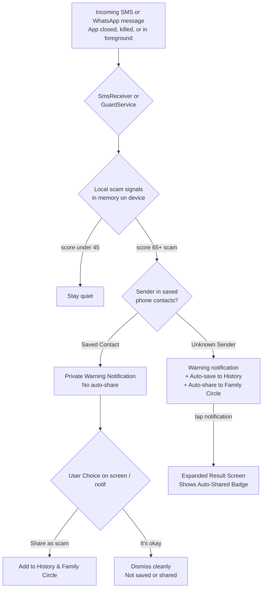

## A 3-minute tour

Open the hosted app in Chrome. No sign-in is needed to check messages.

1. **Check a message.** Tap the *KYC update (India)* example, then **Check it**. The badge under the verdict says where it ran (**On this device** or **Cloud**) and how long it took.
2. **See the routing.** Open **Settings → AI engine**. With Gemini Nano, Smart mode runs on-device. Without it, Chaukas uses Gemini in the cloud after redacting personal details. Tap **See what was sent** on a cloud result to read the privacy receipt.
3. **Go offline.** With Gemini Nano downloaded, turn on airplane mode and check the *Toll fee text* in Private mode.
4. **QR "refund" scam.** Tap the *QR "refund" (India)* example. The QR is decoded on the device: scanning would *send* ₹4,999, not receive it.
5. **Second opinion.** Check the *Job offer on WhatsApp* example on-device and tap **Second opinion** to compare it with the cloud.
6. **If it's too late.** On any scam result, tap **I already paid or shared a code**.
7. **In your language.** On the Check screen, tap **हिन्दी** under *Language*: the whole screen switches to Hindi. Tap **बोलिए** (Speak) and read out a scam text (or paste one). The verdict appears in Hindi too, and **Read aloud** speaks it with three things not to do.
8. **Your language.** In **Settings**, pick Hindi or Spanish and check a message again in the full app.
9. **No copy-paste (phone).** On Android, turn on **Warn me automatically** on the Check screen and send yourself an SMS like *"Your KYC is expired, account blocked today. Update at http://sbi-kyc.top"*. A warning arrives before you open it. On iPhone, select the text in Messages and tap **Share → Chaukas**.

> To enable Gemini Nano: use desktop Chrome 139+, open `chrome://flags/#prompt-api-for-gemini-nano-multimodal-input`, set it to *Enabled*, relaunch, then press **Download** on the AI engine page (Settings → AI engine). Without it, everything still works through the cloud path.

## Hybrid inference

Every model call in the web app goes through the Firebase AI Logic hybrid SDK. Three privacy modes map directly onto `InferenceMode`:

| Mode | Web and Android | iOS | What it means |
|---|---|---|---|
| **Private** | `ONLY_ON_DEVICE` | `SystemLanguageModel` only | Never leaves the device. Works offline. |
| **Smart** (default) | `PREFER_ON_DEVICE` | `HybridModel(primary: device, secondary: Gemini)` | On-device when possible, otherwise cloud with redaction. |
| **Most accurate** | `PREFER_IN_CLOUD` | `HybridModel(primary: Gemini, secondary: device)` | Cloud first with redaction, on-device when offline. |

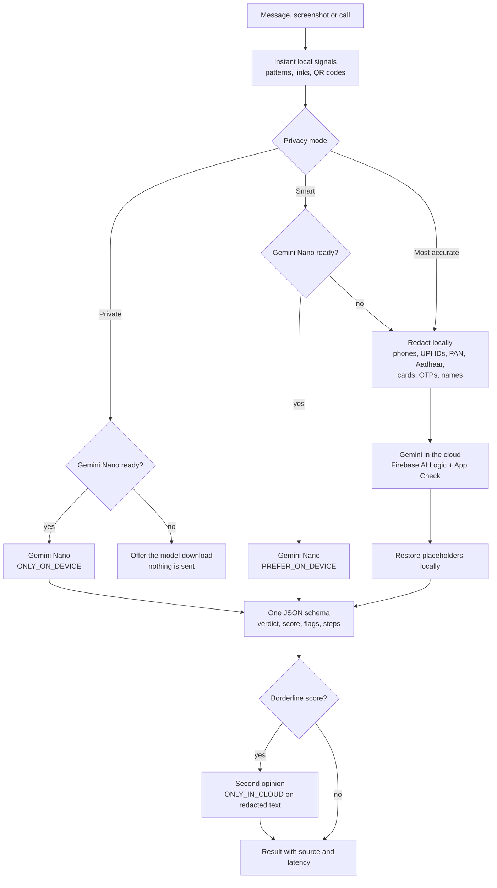

The heart of it is [`web/src/ai/engine.ts`](web/src/ai/engine.ts):

```ts
const model = getGenerativeModel(ai, {
  mode: InferenceMode.PREFER_ON_DEVICE,                 // from the user's privacy mode
  onDeviceParams: {
    createOptions: { expectedInputs: [{ type: 'text' }, { type: 'image' }], expectedOutputs: [{ type: 'text', languages: [lang] }] },
    promptOptions: { responseConstraint: ANALYSIS_SCHEMA },          // Chrome Prompt API
  },
  inCloudParams: {
    model: remoteConfig.cloudModel,                                   // served by Remote Config
    generationConfig: { responseMimeType: 'application/json', responseSchema: ANALYSIS_SCHEMA },
  },
});

const deviceReady = (await deviceAvailability()) === 'available';    // 1. ask before sending
const red = mayLeaveDevice && redactBeforeCloud ? redact(text) : null; // 2. redact only if needed
const result = await model.generateContent(buildPrompt(red?.text ?? text));
result.response.inferenceSource;                                      // 3. 'on_device' | 'in_cloud'
```

Design decisions:

- **Ask before sending.** The app checks Gemini Nano availability itself before each request, so redaction happens only when a prompt will really reach the cloud.
- **One schema, two runtimes.** The same JSON schema is Chrome's `responseConstraint` and Gemini's `responseSchema`, so both paths return the same structured verdict.
- **Repair, don't fail.** Small models sometimes drift. [`parse.ts`](web/src/ai/parse.ts) keeps the score and verdict consistent, and an unreadable answer is never shown as "safe".
- **Escalate on doubt.** Borderline on-device scores (band set in Remote Config) offer an `ONLY_IN_CLOUD` second opinion on redacted text, side by side.
- **Screenshots stay local by default.** Images can't be redacted, so sending them to the cloud is an explicit opt-in.

**Android** ([`HybridEngine.kt`](android/app/src/main/java/app/chaukas/ai/HybridEngine.kt)) uses `firebase-ai` with `firebase-ai-ondevice`: `generativeModel(..., onDeviceConfig = OnDeviceConfig(mode))`, with Gemini Nano through ML Kit / AICore and `FirebaseAIOnDevice.download()` for the model.

**iOS** ([`HybridEngine.swift`](ios/Chaukas/HybridEngine.swift)) uses Firebase AI Logic's `HybridModel`. Apple's on-device Foundation Model (`FirebaseAI.SystemLanguageModel`) and Gemini sit behind one `GenerativeModelSession`, and the response's `modelVersion` says which one answered. Because the SDK picks the route inside the call, iOS redacts every prompt that may reach the cloud.

## Architecture

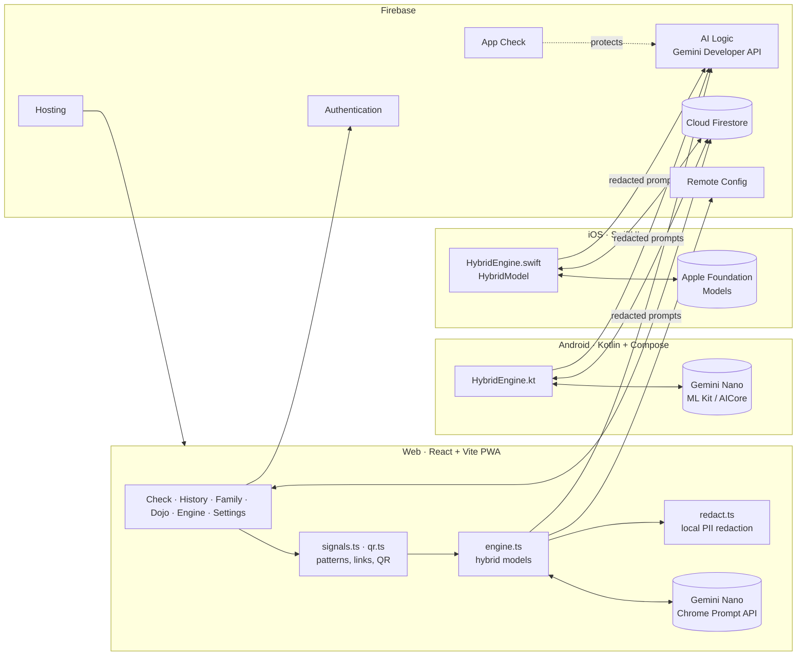

| Firebase product | Used for |
|---|---|
| **AI Logic** | Hybrid inference on all three platforms, streaming follow-ups, Scam Dojo rounds, model download |
| **App Check** | Protects the Gemini API: reCAPTCHA Enterprise on web, Play Integrity on Android, debug providers in development |
| **Authentication** | Anonymous with just a display name, so Family Circle needs no email. Google sign-in is optional, to keep circles on several devices |
| **Cloud Firestore** | Private synced history and Family Circles, with an offline cache |
| **Remote Config** | Cloud model name, second-opinion band, "scam wave" banner, Dojo switch |
| **Hosting** | The PWA, with long-lived caching for hashed assets |

**Data model.** All three apps write the same schema:

| Path | Contents | Access |
|---|---|---|
| `users/{uid}/checks/{id}` | verdict, score, category, redacted summary, redacted excerpt (≤ 160 chars), source, time | Only that user |
| `circles/{code}` | name, owner, members, display names, pending invites | Members, plus people with a pending invite. Anyone may add or remove *only themselves*. Members may invite up to 5 people at a time, and an invite never makes someone a member until they tap **Keep**. The app keeps each person in at most two groups. Members may add only their own, real Chaukas ID to `memberHandles` |
| `handles/{id}` | uid, display name | Signed-in users may look up a single ID (no listing). Each ID is claimed once, by its owner |
| `profiles/{uid}` | your Chaukas ID | Only you |
| `circles/{code}/alerts/{id}` | author, verdict, score, category, redacted summary and excerpt, note, reactions | Members. Each member changes only their own reaction |

## Privacy and security

**What is removed before anything reaches the cloud** ([`redact.ts`](web/src/ai/redact.ts), mirrored in Kotlin and Swift):

| Detail | Example | Becomes |
|---|---|---|
| Phone numbers, including Indian mobiles | +91 98765 43210 | `[PHONE_1]` |
| UPI IDs and emails | name@okaxis, a.b@gmail.com | `[UPI_1]`, `[EMAIL_1]` |
| PAN and Aadhaar | ABCDE1234F, 2345 6789 0123 | `[PAN_1]`, `[AADHAAR_1]` |
| Card numbers (Luhn-checked) and account numbers | 4111 1111 1111 1111 | `[CARD_1]` |
| One-time codes, before or after the keyword | "482913 is your OTP" | `[CODE_1]` |
| Your own words (name, street, bank) | set in Settings | `[NAME_1]` |
| Link query strings | …/pay?id=88213 | …/pay?[QUERY_REMOVED] |

Placeholders are restored on the device, and a privacy receipt shows the exact text that was sent.

**Firestore rules** ([`firestore.rules`](firestore.rules)) enforce exact field shapes and sizes, server timestamps and enum values. They block adding other people to a circle as members, accepting or declining someone else's invite, claiming someone else's ID, posting as someone else, pre-filling or changing other people's reactions, and overwriting an existing circle. Everything not explicitly allowed is denied. Each of these is covered by an emulator test.

## Testing

| Suite | Covers | Command |
|---|---|---|
| Web unit tests (83) | Redaction of Indian and international identifiers (and leaving ordinary numbers alone), link inspector, scam signals, QR/UPI inspector, language prompts, output repair, report and recovery steps for every country, spoken verdict lines in all six languages, casual tone prompts, WhatsApp/SMS links and link defanging, personal Chaukas IDs, WAV encoding for voice input, every built-in example | `cd web && npm test` |
| Lint and types | ESLint with TypeScript and React Hooks rules, `tsc --noEmit` | `npm run lint && npm run typecheck` |
| Firestore rules (23) | Every rule above, against the Firestore emulator | `cd tests/rules && npm install && npm test` |
| Android unit tests | Kotlin redactor, signals, parser, and which notifications the automatic warnings act on | `cd android && ./gradlew testDebugUnitTest` |
| iOS core checks | Swift redactor, signals and parser | see [`ios/Tests/main.swift`](ios/Tests/main.swift) |

All of them run on every push in [GitHub Actions](.github/workflows/ci.yml), together with the Android debug build and the iOS simulator build.

To try Family Circle with two people on one computer, run the Auth and Firestore emulators (`firebase emulators:start --only auth,firestore`), start the web app with `VITE_USE_EMULATORS=true npm run dev`, and open it in two browser profiles.

## Setup

### Requirements

- Node.js 20+, a Firebase project on the Blaze or Spark plan
- Desktop Chrome 139+ for Gemini Nano (optional, about 22 GB free disk)
- Android Studio (Android; its bundled JDK is enough), Xcode 26.2+ and XcodeGen (iOS)

### 1. Firebase project

1. Create a project in the [Firebase console](https://console.firebase.google.com/).
2. **AI Logic**: open *AI Logic → Get started* and choose the **Gemini Developer API**.
3. **Web app**: *Project settings → Your apps → Add app → Web*, and copy the config.
4. **App Check** (required by AI Logic):
   - Development: set `VITE_APPCHECK_DEBUG=true`, run the app once, and register the debug token from the browser console under *App Check → Manage debug tokens*.
   - Production: create a reCAPTCHA Enterprise key, register it as the web app's provider, and set `VITE_RECAPTCHA_ENTERPRISE_SITE_KEY`.
5. **Authentication**: enable *Anonymous* (required) and *Google* (optional).
6. **Firestore**: create a database. Rules are deployed in step 4.
7. **Remote Config** (optional): publish [`remoteconfig.template.json`](remoteconfig.template.json). The app ships with the same defaults.

### 2. Run the web app

```bash
cd web
cp .env.example .env.local   # fill in your Firebase web config
npm install
npm run dev                  # http://localhost:5173
```

Without `.env.local` the app runs in a clearly labelled **preview mode** that uses the local pattern engine only.

### 3. Turn on Gemini Nano

1. Desktop Chrome 139 or newer.
2. Open `chrome://flags/#prompt-api-for-gemini-nano-multimodal-input`, choose **Enabled** and relaunch.
3. In Chaukas, open **Settings → AI engine** and press **Download Gemini Nano**.

### 4. Deploy

```bash
npm install -g firebase-tools
firebase login
cp .firebaserc.example .firebaserc     # your project id
cd web && npm run build && cd ..
firebase deploy --only hosting,firestore:rules,remoteconfig
# once: delete group warnings 3 days old
gcloud firestore fields ttls update expireAt --collection-group=alerts --enable-ttl --project=<your-project-id>
```

### 5. Android

1. Add an Android app with package `app.chaukas` and place `google-services.json` in `android/app/`.
2. Open `android/` in Android Studio and run a debug build. Open the **Engine** tab, copy the App Check debug token shown there (debug builds only) and register it in the Firebase console.
3. On a device with AICore support, open **Engine → Download Gemini Nano**. Share any text to **Check with Chaukas**.
4. To try automatic warnings, turn on **Warn me automatically** on the Check screen and allow notification access. Then tap **Test it now**: it should say *Working*. On Xiaomi, Redmi, Poco, Oppo and Vivo phones also set Autostart on and Battery saver to *No restrictions* in the app settings, or the phone may stop the checker.

### 6. iOS

1. Add an iOS app with bundle ID `app.chaukas` and place `GoogleService-Info.plist` in `ios/Chaukas/`.
2. `brew install xcodegen && cd ios && xcodegen generate && open Chaukas.xcodeproj`
3. Run a debug build and register the App Check debug token from the Xcode console.
4. On-device checks need iOS 26 with Apple Intelligence turned on. Other devices use the cloud with redaction.
5. The `ChaukasShare` target adds **Chaukas** to the share sheet. XcodeGen embeds it in the app automatically.

## Project structure

```
.
├── web/                      React + TypeScript + Vite PWA
│   ├── src/ai/               engine (hybrid), schema, prompts, redact, signals, parse, device, preview
│   ├── src/firebase/         app (App Check, Auth, Firestore), remoteConfig
│   ├── src/data/             settings, history sync, family circle, auth
│   ├── src/lib/              qr, voice, verdictWords, warningCard, report, store, log
│   ├── src/views/            Check, History, Circle, Dojo, Engine, Settings
│   ├── src/components/       Result, ReportCard, Highlighted, ShareToCircle, ui, Icon
│   ├── src/styles/           design tokens and component styles
│   └── src/__tests__/        unit tests
├── android/                  Kotlin + Jetpack Compose (app.chaukas)
│   └── app/src/main/java/app/chaukas/
│       ├── ai/               HybridEngine, Redactor, Signals
│       ├── guard/            GuardService (24/7 foreground), SmsReceiver (OS SMS), GuardBootReceiver, GuardActionReceiver, MessageGuard
│       ├── data/             Repository, LocalHistory, I18n
│       └── ui/               ChaukasRoot, CheckScreen, HistoryScreen, FamilyScreen, DojoScreen, EngineScreen
├── ios/                      SwiftUI, generated with XcodeGen
│   ├── Chaukas/              HybridEngine, Redactor, Signals, Repository, Views
│   ├── ChaukasShare/         share extension with an instant verdict
│   └── Tests/                core logic checks
├── tests/rules/              Firestore security rule tests (emulator)
├── firestore.rules           security rules
├── remoteconfig.template.json
├── firebase.json             Hosting, rules and Remote Config deploy config
└── .github/workflows/ci.yml  web, rules, Android and iOS pipelines
```

## Hackathon requirements

| Requirement | Where |
|---|---|
| Firebase AI Logic hybrid inference, imported and called at runtime | [`engine.ts`](web/src/ai/engine.ts) (`getGenerativeModel` with `onDeviceParams` and `inCloudParams`, `generateContent`, `generateContentStream`, `initializeDeviceModel`) |
| Web / Chrome with Gemini Nano | Desktop Chrome via the Prompt API, with cloud fallback |
| Android with Gemini Nano | [`HybridEngine.kt`](android/app/src/main/java/app/chaukas/ai/HybridEngine.kt) (`OnDeviceConfig`, `InferenceMode`) |
| iOS with Apple Foundation Models via Firebase AI Logic | [`HybridEngine.swift`](ios/Chaukas/HybridEngine.swift) (`HybridModel`, `SystemLanguageModel`) |
| App Check | [`firebase/app.ts`](web/src/firebase/app.ts), Android and iOS app entry points |
| Other Firebase products | Authentication, Cloud Firestore, Remote Config, Hosting |
| Public repository with an open source license | [Apache 2.0](LICENSE) |
| No secrets in the repository | Config comes from `.env.local`, `google-services.json` and `GoogleService-Info.plist`, all git-ignored |
| English support | The app is in English, with 13 more explanation languages and spoken verdicts in 5 Indian languages |

## License

Licensed under the [Apache License, Version 2.0](LICENSE).

Chaukas gives guidance, not guarantees. If money has already been sent, call your bank, and in India call **1930**, straight away.
